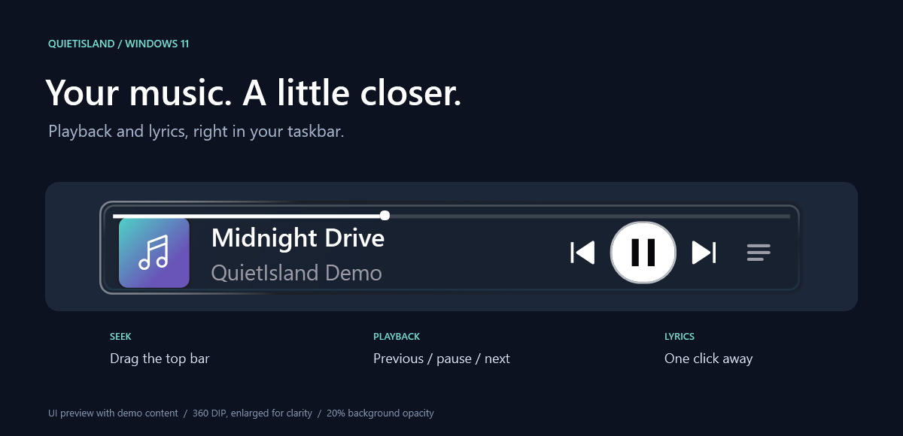
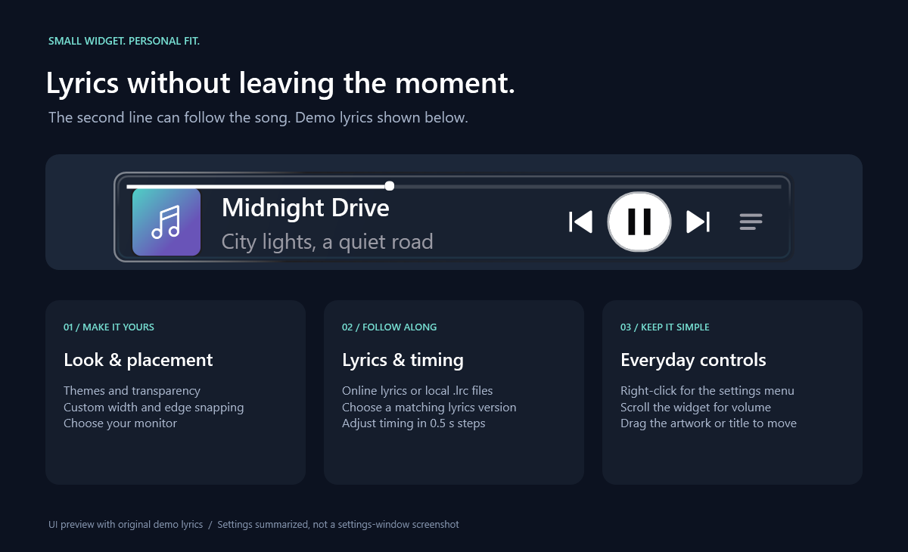

# QuietIsland

<p align="center"></p>

Music, album artwork, and synchronized lyrics in your Windows 11 x64 taskbar.



**[Download the latest release](https://github.com/Shohruh04/QuietIsland/releases/latest)**

**Setup EXE** is recommended: it bundles .NET for offline use and includes an uninstaller. **Portable ZIP** also bundles .NET; extract it and run `QuietIsland.exe`. Uninstall preserves settings and lyrics cache.

**Light ZIP** is a smaller download without .NET. Install [**.NET 10 Desktop Runtime for Windows x64**](https://dotnet.microsoft.com/en-us/download/dotnet/10.0), then extract the ZIP and run `QuietIsland.exe`. All editions work without PowerShell or Windhawk. ZIP editions update manually from the release page.

## Features

- Playback controls, seeking, volume, album artwork, and scrolling titles.
- Online lyrics, local `.lrc` files, and timing adjustment.
- Multiple monitors, edge snapping, custom width, transparency, and themes.
- English/Russian UI, optional startup, and a focus timer.
- Daily update checks with confirmation before downloading/installing; disable them in the tray menu.
- Hides automatically when no media session exists.

Right-click the widget or tray icon for settings. Drag the artwork/title to move, use the top bar to seek, and scroll to adjust volume. `Ctrl+Alt+I` shows the widget; `Ctrl+Alt+D` toggles visibility. Player support depends on Windows Media Controls.



## Development

Requires **.NET 10 SDK** on Windows; installer builds also need **Inno Setup 6.3+ or 7**.

```powershell
dotnet build -c Release
dotnet test Tests/QuietIsland.Tests.csproj -c Release
.\scripts\Build-Installer.ps1
```

Build scripts are developer-only. Output: `artifacts/`. See [changelog](CHANGELOG.md) for versions.

## Privacy and license

Optional online lyrics send track metadata to [LRCLIB](https://lrclib.net/docs). Update checks contact GitHub. Local data stays in `%LocalAppData%\QuietIsland`. No audio recording or analytics.

[MIT](LICENSE) · [Third-party notices](THIRD_PARTY_NOTICES.md) · [Issues](https://github.com/Shohruh04/QuietIsland/issues)

Layout and colors inspired by [Dynamic Island for Windows](https://github.com/devcode90/Dynamic-Island-for-Windows).
