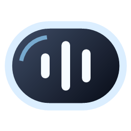

# QuietIsland

<p align="center"></p>
<p align="center"><strong>Music, album artwork, and lyrics in your Windows taskbar.</strong></p>

<p align="center">
  <a href="https://github.com/Shohruh04/QuietIsland/releases/latest"></a>
  <a href="LICENSE"></a>
</p>

## Download

**[Download the latest Windows x64 release](https://github.com/Shohruh04/QuietIsland/releases/latest)**

- **Setup EXE:** recommended; includes .NET and an uninstaller. No administrator rights required.
- **Portable ZIP:** extract all files, then run `QuietIsland.exe`.
- SHA-256 checksums are included with each release.

Designed for Windows 11 x64. Uninstall through **Settings → Apps → Installed apps** or `unins000.exe`. Settings and lyrics cache are preserved.

## Features

- Album artwork, playback controls, click/drag seeking, and mouse-wheel volume.
- Synchronized lyrics from LRCLIB, local `.lrc` files, version selection, and timing adjustment.
- Drag placement, monitor selection, custom width, transparency, and eight color themes.
- Safe placement around Start and app buttons, including a left-aligned taskbar.
- English/Russian UI, optional startup, and a focus timer.
- Automatically hides when no media session exists; paused tracks remain visible.

QuietIsland is a standalone C#/WPF app. It does not require Windhawk or inject into Explorer. Controls depend on what your player exposes through Windows Media Controls.

## Controls

| Action | Control |
| --- | --- |
| Settings | Right-click the widget or tray icon |
| Move | Drag the artwork or song title |
| Seek | Click or drag the top progress bar |
| Volume | Mouse wheel over the widget |
| Lyrics / artist | Three-line button |
| Show | `Ctrl+Alt+I` or double-click the tray icon |
| Toggle visibility | `Ctrl+Alt+D` |

Use the right-click menu to change language, monitor, size, position, theme, transparency, and startup. Secondary monitors need a Windows taskbar enabled. If no safe space is available, the widget hides.

## Build

Requires **.NET 10 SDK** on Windows. The source install script builds the app, creates a shortcut, and enables startup:

```powershell
git clone https://github.com/Shohruh04/QuietIsland.git
cd QuietIsland
.\scripts\Install.ps1
```

To build the self-contained installer and portable ZIP, also install **Inno Setup 6.3+ or 7**, then run:

```powershell
.\scripts\Build-Installer.ps1
```

Output is written to `artifacts/`. The version comes from `QuietIsland.csproj`. Update it and [CHANGELOG.md](CHANGELOG.md), then push a matching `vX.Y.Z` tag to build and publish through GitHub Actions.

## Privacy and contributing

Online lyrics send the track title, artist, album, and duration to LRCLIB. You can disable this in the menu. Settings, cache, and diagnostics stay in `%LocalAppData%\QuietIsland`. No audio recording or analytics.

[Issues](https://github.com/Shohruh04/QuietIsland/issues) and pull requests are welcome. Include your Windows version, player, monitor/DPI setup, and reproduction steps. Close the running app before using `QuietIsland.exe --self-test`.

## License and credits

[MIT](LICENSE). Layout inspired by [Dynamic Island for Windows](https://github.com/devcode90/Dynamic-Island-for-Windows), with adapted color palettes. Built with WPF, Windows Media Controls, [NAudio](https://github.com/naudio/NAudio), and [LRCLIB](https://lrclib.net/docs). See [third-party notices](THIRD_PARTY_NOTICES.md).
